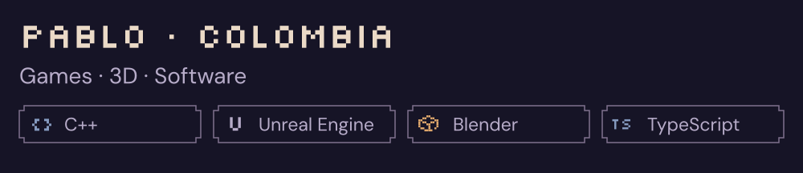
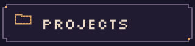
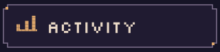
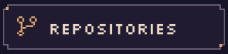
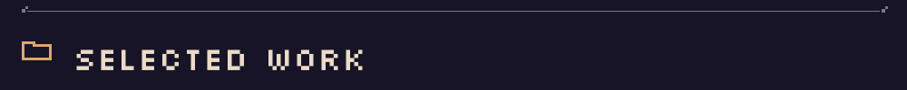
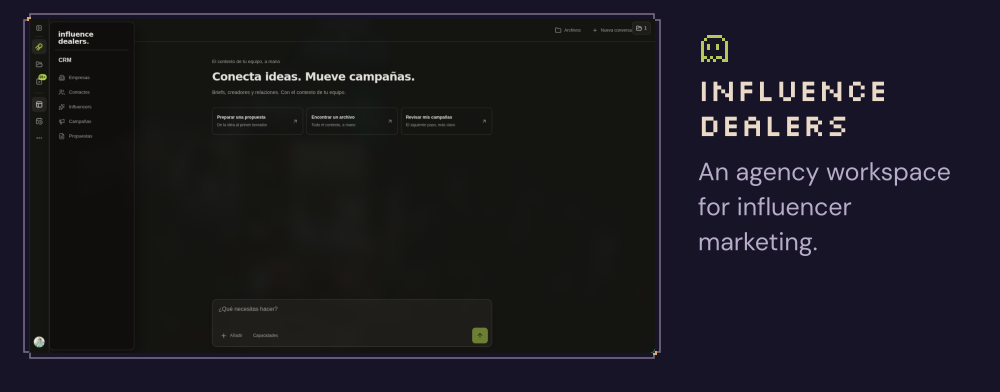
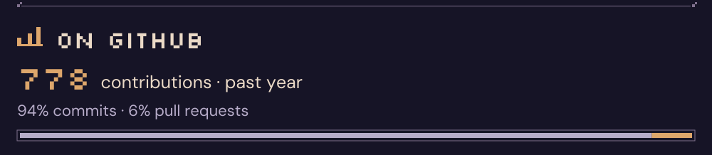
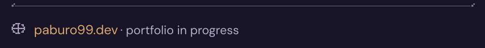

<picture>
  <source media="(prefers-reduced-motion: reduce)" srcset="assets/studio-static.svg">
  
</picture>

<picture>
  <source media="(max-width: 600px)" srcset="assets/intro-mobile.svg">
  
</picture>

  <a href="#projects"><picture><source media="(max-width: 600px)" srcset="assets/nav-projects-mobile.svg"></picture></a>
  <a href="#activity"><picture><source media="(max-width: 600px)" srcset="assets/nav-activity-mobile.svg"></picture></a>
  <a href="https://github.com/Paburo99?tab=repositories"><picture><source media="(max-width: 600px)" srcset="assets/nav-repos-mobile.svg"></picture></a>

<a href="assets/screenshots/sumika-home.png">
  <picture>
    <source media="(max-width: 600px)" srcset="assets/sumika-mobile.svg">
    
  </picture>
</a>

<a href="assets/screenshots/influence-dealers-home.png">
  <picture>
    <source media="(max-width: 600px)" srcset="assets/influence-dealers-mobile.svg">
    
  </picture>
</a>

<a href="https://github.com/Paburo99?tab=overview">
  <picture>
    <source media="(max-width: 600px)" srcset="assets/activity-mobile.svg">
    
  </picture>
</a>

<picture>
  <source media="(max-width: 600px)" srcset="assets/footer-mobile.svg">
  
</picture>

Text version &amp; still image

Pablo, Colombia. Games, 3D and software. I work with C++, Unreal Engine, Blender and TypeScript.

- **Sumika:** a personal workspace for writing, drawing and collecting. [Interface preview](assets/screenshots/sumika-home.png).
- **Influence Dealers:** an agency workspace for influencer marketing. [Interface preview](assets/screenshots/influence-dealers-home.png).
- **paburo99.dev:** my future portfolio, currently in progress.
- [View the still studio](assets/studio-static.svg) · [Public repositories](https://github.com/Paburo99?tab=repositories).

